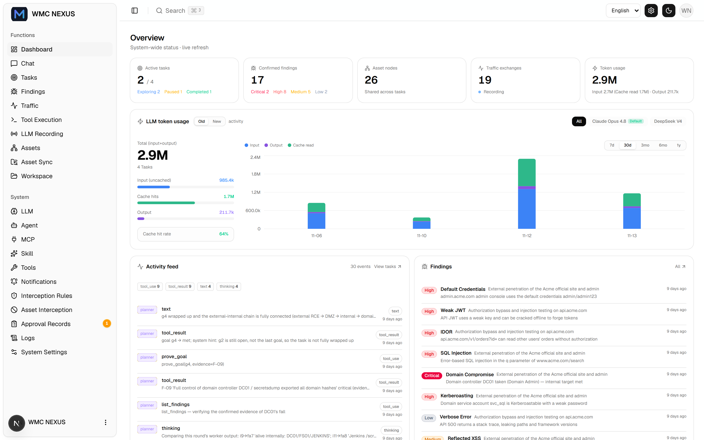

<div align="center">


# WMC NEXUS

**[🇬🇧 English](README.md) · 🇹🇷 Türkçe**

**Otonom, LLM destekli güvenlik değerlendirme platformu — Türkçe öncelikli, genişletilmiş ve güncel saldırı skill kataloğuyla.**

Kendi sunucunda çalışır, modelden bağımsızdır: web arayüzü gömülü tek bir Go binary'si, PostgreSQL ve
kendi Anthropic / OpenAI uyumlu uç noktan ya da yerel bir Ollama. [ARTEX](https://github.com/Autumn-27/ARTEX)
projesinin **tam Türkçe arayüzlü**, **28 skill'lik katalog** (bulut, Kubernetes, Entra ID, CI/CD tedarik
zinciri, AiTM phishing ve **LLM-ajan güvenliği**) ve **Docker'sız Windows kurulumu** eklenmiş modern bir
fork'u. AGPL-3.0; üst kaynak lisans ve bildirimleri korunur.

[](LICENSE)
[](https://github.com/wmcwork/wmc-nexus/actions/workflows/ci.yml)
[](go.mod)
[](web/package.json)
[](#skill-katalogu)

[Hızlı başlangıç](#hızlı-başlangıç) · [Neden WMC NEXUS](#neden-wmc-nexus) · [Skill kataloğu](#skill-katalogu) · [Nasıl çalışır](#nasıl-çalışır) · [Kurulum](#kurulum) · [Windows kurulumu](docs/windows-local-setup.tr.md) · [Güvenlik](SECURITY.md)

<br/>



</div>

---

WMC NEXUS, ARTEX'ten türetilmiş, kendi sunucunda çalışan LLM destekli bir güvenlik değerlendirme
platformudur. Planlayıcı bir hedefi niyetlere böler, işçiler (worker) araçları çalıştırır ve sonuçlar
**birbirine bağlı iki grafiğe** yazılır: biri bilinen varlıklar, diğeri görev ilerlemesi için. Bulgular,
yakalanan istek/yanıt kanıtlarını içerebilir. Tüm eylemler kapsam kuralları, onay kapıları ve bütçelerle
yönetilir.

- **Sohbet etmez, keşfeder.** Hedef ayrıştırma → niyet dağıtımı → işçi yürütme → geri yazma: hedef
  kanıtlanana kadar ilerleyen kapalı bir döngü.
- **İki grafik, tek denetim izi.** Paylaşılan varlık grafiği *neyin var olduğunu*; göreve özel keşif
  grafiği *neyin denendiğini, ne ürettiğini ve nedenini* söyler.
- **Kanıtlı bulgular.** Kayıt yapan bir MITM proxy ve tarayıcı eklentisi gerçek trafiği yakalar; bulgular
  ve yeniden testler tam olarak ilgili istek/yanıta bağlanır.
- **Frenli otonomi.** İnsan onayı, argv-önek kuralları, kapsam/ret kapıları, token ve tur bütçeleri, hedef
  gürültü yöneticisi ve araç çıktısına prompt-injection çerçeveleme.
- **Kendi sunucunda, modelden bağımsız.** Next.js arayüzü gömülü tek Go binary'si, PostgreSQL ve kendi
  Anthropic/OpenAI uyumlu uç noktan veya yerel Ollama.

---

## Neden WMC NEXUS

WMC NEXUS, ARTEX motorunu korur ve modern, Türkçe konuşan bir red team'in gerçekte ihtiyaç duyduğu şeyleri ekler:

| | ARTEX (üst kaynak) | **WMC NEXUS** |
|---|---|---|
| **Arayüz dili** | İngilizce / Çince | **Tam Türkçe + İngilizce arayüz** |
| **Skill kataloğu** | temel set | **28 skill**, 7'si modern modül: ADCS, Entra ID / M365, bulut saldırı yolları, Kubernetes, CI/CD tedarik zinciri, AiTM phishing, **LLM-ajan güvenliği** |
| **Windows kurulumu** | Docker | **Docker'sız derleme + portatif PostgreSQL başlatıcı** |
| **Sürüm güvencesi** | — | İmzalı binary'ler, CycloneDX SBOM, SHA256 sağlama |

Üst kaynaktaki her şey geçerliliğini korur: otonom planlayıcı/işçi döngüsü, ikili varlık + keşif grafiği,
kanıta bağlı bulgular, insan onayları, kapsam/ret kuralları ve çalışma bütçeleri.

---

## Skill kataloğu

28 birinci-parti skill, bir angajmanın tüm yaşam döngüsünü kapsar. Her biri, planlayıcının her ajan için
ayrı ayrı yetkilendirebileceği bağımsız bir modüldür. **🆕 işareti, WMC NEXUS ile eklenen** ve güncel
(2025–2026) saldırı yüzeylerini hedefleyen modülleri gösterir.

**Kapsam, OPSEC & raporlama**
`engagement-scoping` · `opsec-and-cleanup` · `evidence-and-reporting`

**Keşif (Recon)**
`passive-recon` · `active-recon` · `api-recon` · `bbot-recon` · `cloud-recon` · `scopesentry`

**Web & API testi**
`web-app-testing` · `api-security` · `auth-session-testing` · `playwright-cli` · `php2shell`

**Kimlik, Active Directory & bulut**
`ad-enumeration` · `adcs-abuse` 🆕 · `entra-id-attack` 🆕 · `cloud-attack-path` 🆕 · `k8s-container-security` 🆕

**Düşman simülasyonu (C2, phishing, atlatma)**
`c2-operations` · `aitm-phishing` 🆕 · `phishing-simulation` · `edr-bypass-re`

**Kod, tedarik zinciri & tersine mühendislik**
`codeaudit` · `patch-diff` · `cicd-supply-chain` 🆕 · `rea`

**Yapay zeka / LLM güvenliği**
`llm-agent-security` 🆕 — doğrudan/dolaylı prompt injection, araç istismarı ve veri sızdırma zincirleri,
RAG zehirleme ve guardrail atlatma; PyRIT / garak / AgentDojo ile ölçüm.

> Skill'ler ajan başına isteğe bağlı açılır (**Sistem → Ajan → *ajan* → Beceri**). Yalnızca angajmanın
> ihtiyaç duyduğunu yetkilendir; tüm etkinlik kapsam kuralları, onay kapıları ve bütçelerle yönetilmeye
> devam eder.

---

## Hızlı başlangıç

Docker'sız Windows kurulumu için [Windows kurulumu (Türkçe)](docs/windows-local-setup.tr.md) rehberini
izle. Yerel bir PostgreSQL servisi gerekir; Docker gerekmez.

Docker tabanlı yol da kullanılabilir:

```bash
git clone https://github.com/wmcwork/wmc-nexus.git
cd wmc-nexus
cp .env.example .env            # POSTGRES_PASSWORD (ve istersen bir LLM anahtarı) ayarla
docker compose up -d --build    # checkout'tan derler, PostgreSQL'i başlatır
```

**http://localhost:8787** adresini aç. İlk ziyarette `/setup`, başlangıçta yazdırılan tek kullanımlık
kurulum token'ını ister:

```bash
docker compose logs artex | grep "Setup token"
```

> Çekilecek hazır bir Docker imajı yoktur: imaj her zaman senin checkout'undan derlenir.
> Tüm kurulum yolları için İngilizce [README'deki Installation](README.md#installation) bölümüne bak.

---

## Nasıl çalışır

Mimarinin ayrıntıları (ikili grafik mimarisi, motor döngüsü, kalıcı saldırı zincirleri, kanıt yönetimi),
ekran görüntüleri ve tüm yapılandırma seçenekleri İngilizce README'de ayrıntılıdır:
[How it works](README.md#how-it-works) · [Features](README.md#features) · [Configuration](README.md#configuration).

---

## Kurulum

Beş kurulum yolu vardır (tek tıkla betik, Docker Compose, Docker'sız Windows derlemesi, hazır binary'ler,
kaynaktan tek binary). Hepsinin ayrıntısı için: [Installation](README.md#installation).

En hızlı Türkçe yol: [Docker'sız Windows kurulumu](docs/windows-local-setup.tr.md).

---

## Güvenlik ve sorumlu kullanım

WMC NEXUS saldırgan güvenlik yetenekleri içerir ve **yalnızca yetkili** güvenlik testleri, araştırma ve
eğitim içindir. Yalnızca açıkça yazılı izninin olduğu sistemlerde kullan. Yasa dışı kullanım yasaktır ve
sorumluluk tamamen kullanıcıya aittir. Ayrıntılar: [SECURITY.md](SECURITY.md) ve İngilizce README'deki
[License and disclaimer](README.md#license-and-disclaimer).

---

## Bu fork hakkında

WMC NEXUS, [Autumn-27](https://github.com/Autumn-27) tarafından oluşturulan ve
[BaaRai/ARTEX](https://github.com/BaaRai/ARTEX) olarak İngilizce sürümü sürdürülen ARTEX'in markalı bir
türevidir. Üst kaynak AGPL-3.0 ile lisanslıdır; bu depo o şartları ve bildirimleri korur. WMC NEXUS için
yapılan değişiklikler [CHANGELOG.md](CHANGELOG.md) ve [NOTICE](NOTICE) dosyalarında kayıtlıdır.

---

## Lisans

[AGPL-3.0](LICENSE). Ağ üzerinden erişilen dağıtımlarda dahi kaynak kodu erişilebilir tutulmalıdır.
